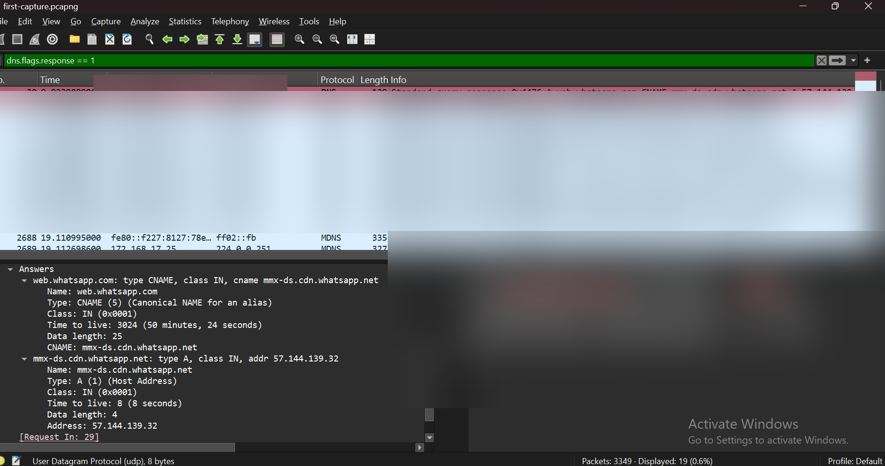
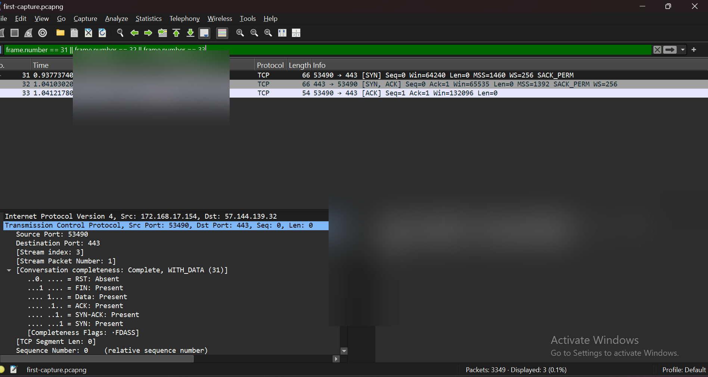

# Network Traffic Analysis Using Wireshark

## 1. Project Overview

This project demonstrates practical network traffic capture and analysis using Wireshark. It focuses on understanding network communication, identifying protocols and examining how devices exchange information.

## 2. Project Objectives

- Capture live network traffic.
- Identify and analyse DNS queries and responses.
- Understand TCP connection establishment.
- Apply Wireshark display filters.
- Interpret network packets and protocol information.
- Practise basic network security analysis.

## 3. Tools and Technologies

- Wireshark – Network protocol analyser.
- Npcap – Packet capture driver.
- Git – Version control.
- GitHub – Project hosting and documentation.
- Visual Studio Code – Code and documentation editor.

## 4. Protocols Analysed

### DNS (Domain Name System)

Examined DNS queries and responses, including CNAME and A records, to understand hostname resolution.

### TCP (Transmission Control Protocol)

Investigated TCP flags, including SYN and ACK, and examined the three-way handshake used to establish TCP connections.

## 5. Methodology

1. Installed and configured Wireshark and Npcap.
2. Selected an available network interface.
3. Captured live network traffic.
4. Applied display filters to isolate DNS and TCP packets.
5. Inspected packet headers and protocol details.
6. Documented observations and findings.

## 6. Project Structure

```text
network-traffic-analysis/
├── captures/
├── screenshots/
├── analysis/
├── README.md
└── findings.md
```

## 7. Key Skills Demonstrated

- Network traffic analysis
- Packet inspection
- DNS resolution analysis
- TCP protocol analysis
- Wireshark display filters
- Technical documentation
- Git and GitHub version control

## 8. Security and Privacy

Traffic was captured for educational analysis on an authorised network. Sensitive network identifiers and private information are excluded from published documentation.

## 9. Project Status

**<u>Completed</u>**

The network traffic analysis project has been successfully completed and published on GitHub. The following activities were carried out:

- Captured live network traffic using Wireshark.
- Identified and analysed DNS queries and responses.
- Examined DNS CNAME and A records.
- Analysed TCP connection establishment through the three-way handshake (SYN, SYN-ACK and ACK).
- Applied Wireshark display filters to isolate relevant packets.
- Documented technical observations and findings.
- Prepared and published redacted screenshots as supporting evidence.
- Used Git and GitHub for version control and project publication.

The project demonstrates foundational practical skills in network protocol analysis, packet inspection, DNS resolution and TCP communication.

## 10. Wireshark Evidence

### DNS Response Analysis



### TCP Three-Way Handshake


